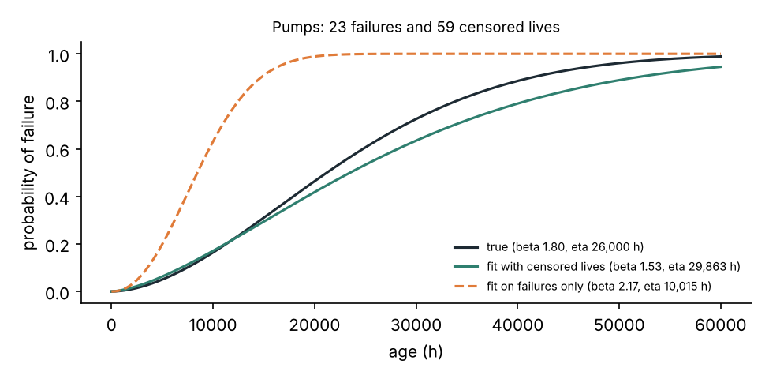
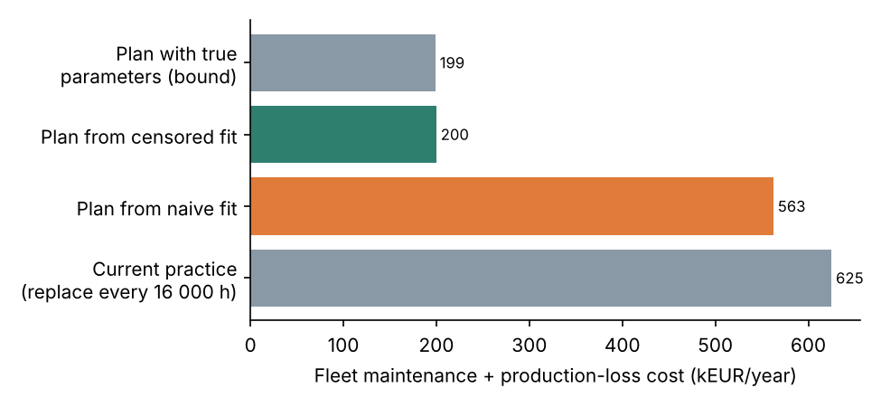
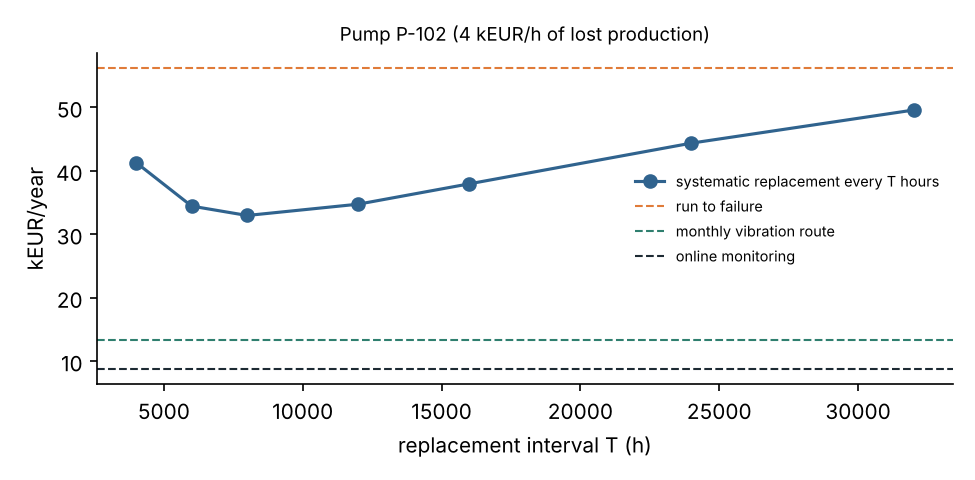

# Jumeau de fiabilité des machines tournantes d'une unité de procédé

[](https://github.com/Abderrahmane-BOULAMI/rotating-reliability-twin/actions/workflows/tests.yml)

Une unité de procédé compte des dizaines de pompes, de compresseurs et de ventilateurs. La question du responsable
maintenance est toujours la même : **pour chaque machine, faut-il la laisser tourner jusqu'à la panne, la remplacer
à intervalle fixe, la surveiller par des tournées vibratoires ou l'équiper d'un capteur en continu ?** Ce projet y
répond avec un jumeau de fiabilité de la flotte :

1. **Analyse de durée de vie (Weibull)** à partir de l'historique de maintenance, en traitant correctement les
   remplacements préventifs comme des durées **censurées** (la machine n'était pas en panne).
2. **Simulation des stratégies** de maintenance machine par machine (Monte Carlo, renouvellement-récompense) :
   coût annuel, pannes par an, disponibilité, en tenant compte de la perte de production.
3. **Une validation** de la simulation contre le modèle analytique de remplacement par âge.
4. **Une matrice de criticité** (conséquence × fréquence) et **un plan de maintenance** exporté sous Excel.

La flotte (28 machines), les lois de durée de vie, l'intervalle P-F (temps entre défaut détectable et panne) et les
coûts sont des **hypothèses** réunies dans [`config/fleet.yaml`](config/fleet.yaml), à remplacer par l'historique
de la GMAO.

## Résultats

### 1. Ignorer les durées censurées fausse tout

8 ans d'historique sous la pratique actuelle (remplacement systématique toutes les 16 000 h).

| Classe | Vies observées | Pannes | B10 vrai (h) | B10, censure prise en compte (h) | B10, pannes seules (h) |
|---|---|---|---|---|---|
| Pompes | 82 | 23 | 7 448 | 6 866 (IC 90 % : 4 871 à 9 249) | 3 551 |
| Ventilateurs | 38 | 8 | 6 692 | 7 391 (IC 90 % : 3 931 à 14 709) | 2 185 |
| Compresseurs | 18 | 2 | 16 445 | 13 891 (IC 90 % : 7 248 à 14 515) | 7 008 |

Le calcul « sur les pannes seules », courant dans un tableur, **divise la durée de vie par deux ou trois**. Avec
2 pannes seulement, l'estimation des compresseurs reste fragile : l'intervalle de confiance par rééchantillonnage
ne contient même pas la vraie valeur. C'est une information pour le responsable : il faut plus de données avant de
décider sur cette classe.



### 2. Stratégie machine par machine : coûts de la flotte divisés par trois

| Plan | Coût maintenance + pertes (k€/an) | Pannes par an |
|---|---|---|
| Pratique actuelle (remplacement toutes les 16 000 h) | 625 | 4,9 |
| Plan bâti sur l'ajustement « pannes seules » | 563 | 0,5 |
| **Plan bâti sur l'ajustement avec censure** | **200** | 1,5 |
| Plan avec les vrais paramètres (borne) | 199 | 1,2 |

Le plan retient 8 surveillances en continu (machines sans secours ou critiques), 18 tournées vibratoires mensuelles
et 2 ventilateurs laissés en corrective. Construit sur une mauvaise statistique, le plan surinvestit en surveillance
et coûte presque autant que la pratique actuelle ; construit sur la bonne, il est à 0,5 % de l'optimum.




### 3. Validation et sensibilité

- La simulation retrouve le coût analytique du remplacement par âge à **0,3 % près** (200 000 cycles).
- Pour la pompe P-104 (6 k€/h de perte de production), la surveillance en continu reste la meilleure option même si
  l'intervalle P-F est divisé par 10 (120 h) ; son coût passe alors de 10,5 à 22,2 k€/an, toujours moitié moins que
  le meilleur remplacement systématique (45,6 k€/an).

## Limites

- Les gains dépendent fortement de l'intervalle P-F et de la probabilité de détection supposés : à mesurer sur le
  site (historique des alarmes vibratoires et des pannes) avant toute décision.
- Un seul mode de défaillance par classe de machine ; pas de défaillance aléatoire (électronique, erreur humaine).
- La perte de production est supposée constante par heure d'arrêt.

## Lancer le projet

```bash
pip install -r requirements.txt
pytest -q                        # 8 tests
python experiments/run_all.py    # tableaux, figures et results/maintenance_plan.xlsx (quelques secondes)
```

## Organisation

```
config/fleet.yaml       flotte, lois de durée de vie, coûts, surveillance
reltwin/weibull.py      historique simulé, ajustement Weibull avec censure, B10, intervalle de confiance
reltwin/strategies.py   simulation des stratégies, modèle analytique de référence
reltwin/plan.py         criticité, choix de stratégie par machine, export Excel
results/                chiffres, figures, plan de maintenance
```

Licence MIT.
